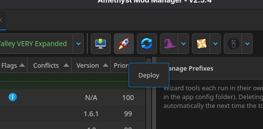
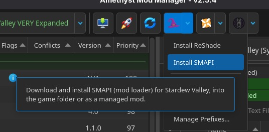
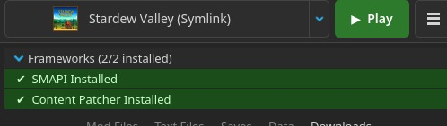
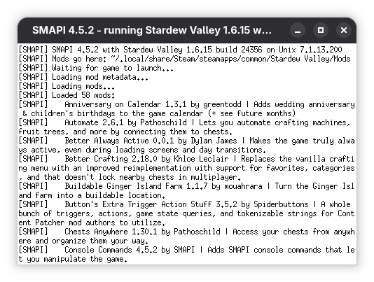
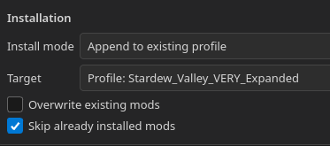

# Install with Amethyst
*Applies to: Stardew Valley 1.6.15+ Last reviewed: 2026-11-02*

Amethyst is a supported manager for these collections on Linux, including Steam Deck. It is not a Windows app.

Using a different manager? See [Install with Vortex](vortex.md) or [Install with Stardrop](stardrop.md).

## Install Amethyst

These steps follow the [Amethyst README](https://github.com/ChrisDKN/Amethyst-Mod-Manager).

The application may ask to set a password. This is for the OS keyring to store your Nexus API key, as Amethyst does not store it in a plain text file. Set the password to anything you want.

### AppImage

Run the following command in a terminal. It will appear in your applications menu under Games and Utilities.

```bash
curl -sSL https://raw.githubusercontent.com/ChrisDKN/Amethyst-Mod-Manager/main/src/appimage/Amethyst-MM-installer.sh | bash
```

Alternatively, download the AppImage from the [release page](https://github.com/ChrisDKN/Amethyst-Mod-Manager/releases) and install it with Gear Lever.

The application will notify you when a new update goes live. Pressing the update button will rerun the script and update to any new version.

### Alternative: Flatpak

Amethyst can also be installed as a Flatpak. AppImage is the recommended installation method for this guide.

For current Flatpak installation, update, and beta-branch instructions, see the [Amethyst README](https://github.com/ChrisDKN/Amethyst-Mod-Manager).

### Alternative: From Nexus Mods

Download [Amethyst from Nexus Mods](https://www.nexusmods.com/site/mods/1714).

After the download has finished, unzip it and run the `Amethyst-MM-installer.sh` installer script.

This method is the same as the AppImage method, but without the curl command.

## Profiles

Amethyst, Vortex, and other mod managers allow for different profiles. Profiles determine which mods are used when you launch the game. There are many ways to set up and configure profiles within Amethyst, however the documentation on this page uses the simplest version.

## Installation Process


For Amethyst's own button-by-button guide, see [Installing a collection](https://github.com/ChrisDKN/Amethyst-Mod-Manager/wiki/3.4-Installing-a-collection) in the official Amethyst wiki.


Follow these steps to install a collection. Browse available [Jenna Juffuffles' collections](https://www.nexusmods.com/profile/JennaJuffuffles/collections).

### Install a collection

What Amethyst does with a Nexus collection:

- It downloads the collection and applies the curator's load order, bundled files, and mod diff patches.
- On the collection page you can change the revision before you install. When you install, Amethyst asks whether to make a new profile or append to an existing profile.
- Amethyst includes a wizard that installs SMAPI. You can also install SMAPI from [smapi.io](https://smapi.io/) for Linux before you play.
- Aesthetic Valley Fairycore and Aesthetic Valley Witchcore are mutually exclusive. Append one of them, not both. Enable only one farm map.

### Step-by-Step Installation

1. Ensure Amethyst is open
2. Click **Add Collection** on the collection page
3. Pop-up in browser will ask you to use a Mod Manager, click **Continue**. Although the pop-up will say that Vortex is required, Amethyst will be used instead.
4. Amethyst will display the collection. You can choose to create a new profile for the collection, or group it together with an existing one. A new profile is recommended.
5. Click **Install Collection**
6. If Amethyst prompts about optional mods, follow the on-screen instructions for each one.

After the collection finishes installing, deploy your profile before launching Stardew Valley.



## Optional Mods

Collections may include optional mods. Install the required mods. When Amethyst prompts about optional mods during installation, follow the on-screen instructions for each one.

## Installing SMAPI

SMAPI (Stardew Modding API) is the framework that makes mods work. You need to connect it to your game so mods can load.

### Amethyst's SMAPI wizard

From Amethyst, click the **Wizard** icon and then the **Install SMAPI** option.



### Verifying SMAPI Connection

**Check in Amethyst:**
- Amethyst should have text saying, **SMAPI Installed** and **Content Patcher Installed**



**Check in-game:**
1. Click **Play** in Amethyst
2. The game should start with the SMAPI console window
3. You'll see mod loading messages in the console



### Installing Multiple JennaJuffuffles Collections

Install the first collection as normal, then add the next from its Nexus page and choose **Append to existing profile** in Amethyst. Change Target to the profile you want to add it to.



**New Profile (start here)**
* [Stardew Valley VERY Expanded (svVe)](https://www.nexusmods.com/games/stardewvalley/collections/tckf0m) collection (svVe): Create a new profile. This is the default.
* [Aesthetic Valley Fairycore](https://next.nexusmods.com/stardewvalley/collections/tjvl0j) or [Aesthetic Valley Witchcore](https://next.nexusmods.com/stardewvalley/collections/g14kxi): Pick one. Can alternatively be added to svVe profile

**Add to your svVe profile**
* [Oops! All Portraits: Nyapu](https://www.nexusmods.com/games/stardewvalley/collections/falitk)
* Any svVe translation collection (check version)

**Add to any working profile**
* [Controller Support](https://www.nexusmods.com/games/stardewvalley/collections/crx9cn)
* [Aesthetic Valley Fairycore Extra Textures](https://www.nexusmods.com/games/stardewvalley/collections/i8ulwo/)
* [Aesthetic Valley Witchcore Extra Textures](https://www.nexusmods.com/games/stardewvalley/collections/ufo0fl/)


**Aesthetic Valley Fairycore** and **Aesthetic Valley Witchcore** primary collections. Install **one** per profile, not both. Extras do not have this restriction.


## Related

- [Installing a collection](https://github.com/ChrisDKN/Amethyst-Mod-Manager/wiki/3.4-Installing-a-collection) - Official Amethyst wiki steps
- [Update with Amethyst](../Update/amethyst.md)
- [Steam Deck](steam-deck.md)
- [Your SMAPI Log](../Troubleshooting/your-smapi-log.md)
